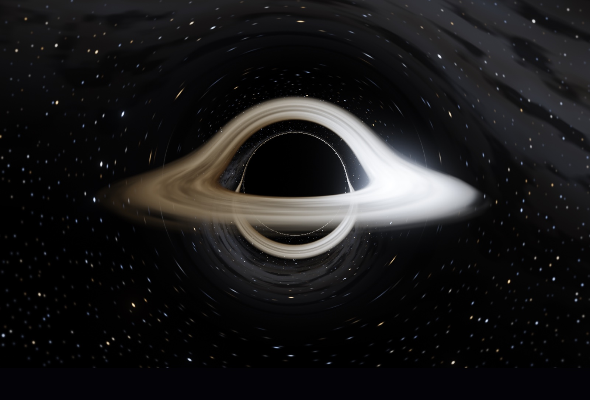

# GARGANTUA

A real-time, general-relativistic ray tracer for a Schwarzschild black hole, running
entirely in the browser on WebGL2. For every pixel of every frame the GPU fires a light
ray backwards from the camera and integrates it as a null geodesic through curved
spacetime until it hits the accretion disk, falls through the horizon, or escapes to
the stars. The result is the full set of effects you would see with your own eyes:
the lensed shadow, the photon ring, the disk wrapping over the poles, Doppler beaming
that lights up the approaching side, gravitational redshift darkening the inner edge,
and HDR bloom with filmic tone mapping on top. Everything is procedural; there are no
textures, no libraries, and no build-time dependencies beyond Node for the bundler.



## Run it

| Goal | Command |
|---|---|
| Just look at it | Open `dist/index.html` directly in a WebGL2-capable browser (Chrome, Edge, Firefox, Safari 15+). No server needed. |
| Develop | `cd black-hole && python3 -m http.server` then open <http://localhost:8000/>. The dev page fetches `src/scene.frag.glsl` and `src/app.js` separately, so edits reload with a refresh. |
| Rebuild the single file | `node build.mjs` inlines the stylesheet, the engine script and the shader into `dist/index.html`. |

The explainer panel ("Physics") is hidden on screens narrower than 900 px to leave
room for the render; the controls panel becomes a bottom sheet. Everything is still
reachable on desktop or a tablet in landscape.

## Controls

| Input | Action |
|---|---|
| Left-drag / one-finger drag | Orbit the camera around the hole |
| Mouse wheel / pinch | Dolly in and out (clamped to 2.6 … 400 M) |
| Arrow keys | Orbit |
| `+` / `−` | Dolly |
| `Space` | Pause / resume coordinate time |
| `H` | Hide or show all UI panels |
| `S` | Save a screenshot (PNG) |
| `R` | Reset camera and settings |
| `1` – `5` | Camera presets: Interstellar, Edge-on, Top-down, Far, Close |
| **Controls** button | Toggle the control panel (camera, disk, physics switches, render quality) |
| **Physics** button | Toggle the in-app explainer |

The control panel exposes the field of view, the disk's inner and outer radius,
brightness, peak temperature, turbulence and time scale; switches for lensing, Doppler
beaming, gravitational redshift, observer blueshift and pause; and the render scale,
integration steps, exposure, bloom and star brightness. Hover any label for a
one-sentence description. The current state is also available in the console as
`window.BH` (`params`, `camera`, `setPreset(name)`, `screenshot()`).

## Physics in brief

A Schwarzschild black hole has no spin and no charge; its geometry is fixed by a single
number, the mass *M*. Working in geometric units (below) the event horizon is at
*r* = 2, the photon sphere, where light can orbit in a circle, is at *r* = 3, and the
innermost stable circular orbit (ISCO) for matter, which sets the inner edge of the
disk, is at *r* = 6. Any ray that passes inside the photon sphere is captured, so the
hole casts a shadow of apparent radius √27 ≈ 5.2 M, noticeably larger than the horizon.
Light that loops around the hole one or more times before escaping forms the thin,
bright photon ring at the shadow's edge. Light from the far side of the disk is bent
over and under the hole, which is why a nearly edge-on disk appears to arch above and
below the shadow. Gas at the ISCO orbits at roughly half the speed of light, so the
approaching side is strongly brightened and blueshifted by Doppler beaming while the
receding side is dimmed and reddened; on top of that, light climbing out of the well
is gravitationally redshifted, so the inner disk looks cooler and dimmer than it is.

The in-app **Physics** panel walks through each of these with a diagram.

## Units and equations

Geometric units, *G* = *c* = *M* = 1. All lengths are in units of the gravitational
radius *GM/c²*; the Schwarzschild radius is *r*<sub>s</sub> = 2. Time is in the same
units (the time light takes to cross one *M*), and the "Time scale" slider is in
*M* per real second.

| Quantity | Expression |
|---|---|
| Ray trajectory (Binet form, *u* = 1/*r*, derivative w.r.t. azimuth φ) | *u*″ + *u* = 3*M u*² |
| Horizon / photon sphere / ISCO | *r* = 2*M*, 3*M*, 6*M* |
| Shadow radius (critical impact parameter) | *b*<sub>c</sub> = √27 *M* ≈ 5.196 *M* |
| Keplerian angular velocity of disk gas | Ω(*r*) = *r*<sup>−3/2</sup> |
| Redshift factor, emitter in circular orbit, observer at infinity | *g* = √(1 − 3*M*/*r*) / (1 − Ω *L*), where *L* is the photon's angular momentum per unit energy about the spin axis |
| Observed intensity (Liouville invariance of *I*/ν³, integrated over frequency) | *I*<sub>obs</sub> = *g*<sup>4</sup> *I*<sub>em</sub> |
| Observed colour | Blackbody at *T*<sub>obs</sub> = *g T*<sub>em</sub> |
| Static observer at radius *r*<sub>cam</sub> (optional) | extra factor 1 / √(1 − 2*M*/*r*<sub>cam</sub>) on *g* |
| Disk temperature (Novikov–Thorne, thin disk) | *T*(*r*) ∝ [ *r*<sup>−3</sup> (1 − √(*r*<sub>in</sub>/*r*)) ]<sup>1/4</sup>, normalised so its peak equals the "Temperature" slider |

Each ray is integrated directly in pseudo-Cartesian coordinates with a classical
RK4 step on the equivalent central-force law d²**p**/dλ² = −3*M h*² **p** / *r*⁵
(*h* = |**p** × **v**| conserved), which reproduces the Binet equation above exactly;
disk crossings are detected by the sign change of *y* between steps and resolved by
linear interpolation. The step length is proportional to *r* (fine near the hole,
coarse far away) up to a maximum step count (the "Ray steps" slider), with early exit
on horizon capture, escape beyond a far sphere, or when the ray has been fully
absorbed by the (partially translucent) disk; rays otherwise continue through the
disk so lensed secondary images stay visible.

## Known limitations

- **Schwarzschild, not Kerr.** No spin, so no frame dragging, no asymmetric shadow,
  and the ISCO is fixed at 6 M. Interstellar's Gargantua was a near-extremal Kerr hole.
- **Thin disk.** The disk has zero thickness and no vertical structure; there is no
  self-shadowing, no plunging region inside the inner edge, no corona, no jets.
- **No radiative transfer.** Emission is a blackbody at the Novikov–Thorne temperature
  times a brightness multiplier; the disk's only opacity is a simple per-crossing
  alpha that lets lensed secondary images show through, with no scattering.
- **Procedural turbulence.** The streaks are noise advected with the Keplerian flow,
  not magnetohydrodynamics.
- **Procedural sky.** The stars and background glow are generated in the shader; they
  are not a real star catalogue.
- **Bounded-step integration.** The step scales with *r* but the step *count* is
  capped by the slider, so very low step counts (especially from far away) will
  visibly degrade the photon ring and the far-side disk image; the slider floor is
  set to keep this tolerable at the default distances.
- **Performance.** Full-resolution rendering on a high-DPI display is heavy; the
  default render scale is 0.75×. Use 0.5× on integrated GPUs and 1.5× for stills.

## File layout

```
black-hole/
├── index.html           page shell, HUD, control panel, physics explainer
├── src/
│   ├── style.css        all styling (no external fonts or frameworks)
│   ├── app.js           engine: WebGL2 host, camera, post-processing, UI binding
│   └── scene.frag.glsl  the physics: geodesic integration, disk, stars
├── build.mjs            inlines everything into a single file
├── dist/
│   └── index.html       the built, dependency-free single-file app
├── CONTRACT.md          integration contract between the workstreams
└── README.md            this file
```

Everything is procedural with zero runtime dependencies: no npm packages, no CDN
scripts, no fonts, no textures. The built `dist/index.html` is the entire application.
